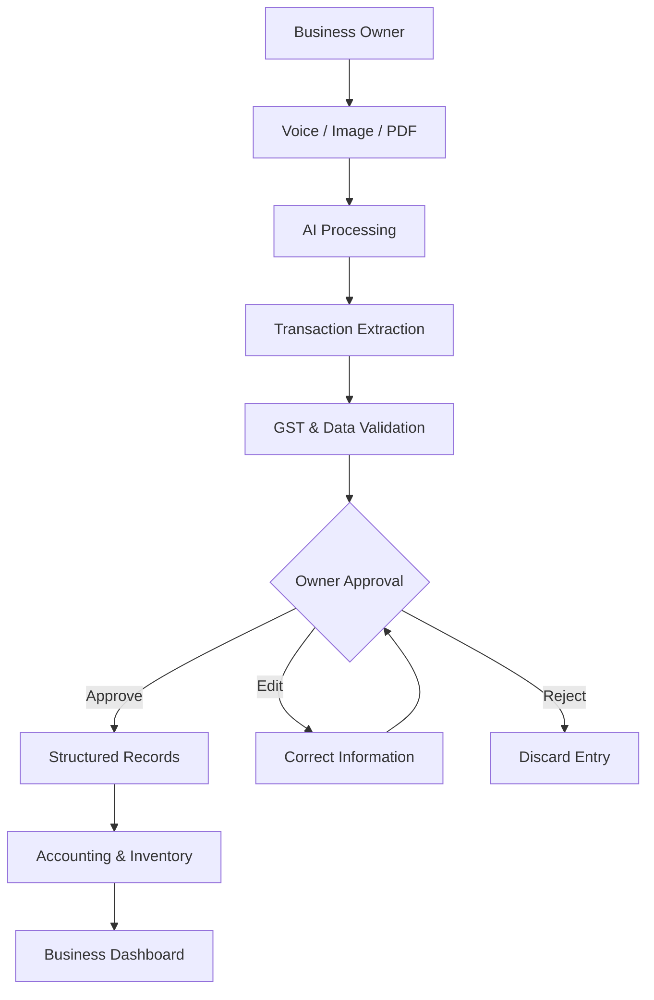

# Ledgr — Your Business, Simplified.

<p align="center">
  
  
  
  
</p>

<p align="center">
  <strong>An AI-powered back-office assistant built for India's small businesses.</strong>
  <br/>
  From everyday business conversations to organized accounting operations.
</p>

---

## Overview

**Ledgr** is an AI-powered business operations assistant designed to simplify accounting, inventory management, GST workflows, and everyday administrative tasks for small businesses in India.

Small business owners often spend hours managing handwritten bills, purchase records, invoices, stock updates, and accounting entries.

Ledgr aims to change that.

Instead of manually entering every transaction, business owners can interact with an intelligent assistant using natural language, voice notes, images of bills, and documents.

Ledgr processes this information, extracts relevant transaction details, validates them, and prepares structured records for review and approval.

**Our vision is to make business management as simple as having a conversation.**

## The Problem

Small businesses across India face several operational challenges:

- Manual bookkeeping and repetitive data entry.
- Managing handwritten invoices, bills, and challans.
- Difficulty tracking purchases, sales, and inventory.
- Complex GST calculations and tax classifications.
- Language barriers in traditional accounting software.
- Time-consuming administrative workflows.
- Dependence on accounting expertise for routine operations.

Traditional accounting tools often require users to adapt to complicated software workflows.

Ledgr takes a different approach: **Let technology adapt to the way businesses communicate.**

## Our Solution

Ledgr introduces a conversational AI-powered workflow that transforms everyday business information into structured accounting operations.

Business owners can provide information through:

- Voice notes in Indian languages.
- Images of handwritten bills and invoices.
- PDF invoices and delivery challans.
- Natural-language business instructions.
- Everyday transaction details.

The AI assistant is designed to extract information, identify inconsistencies, validate transaction details, and prepare accounting entries for human approval.

## Key Features

### 1. Intelligent Document Processing
- Extract transaction details from invoices and bills.
- Identify suppliers, products, quantities, and prices.
- Convert unstructured documents into organized information.
- Reduce repetitive manual data entry.

### 2. Multilingual AI Assistant
- Conversational business interactions.
- Voice-based transaction entry.
- Support for Indian-language workflows.
- Simplified interaction for non-technical business owners.

### 3. Smart Accounting
- Purchase and sales transaction management.
- Organized accounting records.
- Ledger-oriented transaction workflows.
- Structured financial information.

### 4. GST Intelligence
- GSTIN identification and validation workflows.
- HSN classification assistance.
- GST rate identification.
- Tax calculation and invoice preparation.

### 5. Inventory Management
- Product and stock tracking.
- Purchase and sales monitoring.
- Inventory movement visibility.
- Organized product information.

### 6. Human-in-the-Loop Verification

Financial accuracy matters.

Ledgr follows a human-verification approach in which AI-generated transaction details can be reviewed, edited, and approved before being finalized.

**AI assists. Business owners stay in control.**

## How Ledgr Works



## Technology Stack

| Technology | Purpose |
|---|---|
| Next.js 16 | Full-stack web framework |
| React 19 | User interface |
| TypeScript | Type-safe development |
| Tailwind CSS 4 | UI styling |
| Lucide React | Icons |
| Docker | Application containerization |
| Google Cloud Build | Build automation |
| Google Cloud | Deployment infrastructure |

## Project Structure

```text
Ledgrr/
│
├── public/
│
├── src/
│   ├── app/
│   │
│   ├── components/
│   │   ├── dashboard/
│   │   ├── layout/
│   │   └── profile/
│   │
│   ├── data/
│   │
│   ├── lib/
│   │
│   └── types/
│
├── .dockerignore
├── .gitignore
├── AGENTS.md
├── app.yaml
├── cloudbuild.yaml
├── Dockerfile
├── eslint.config.mjs
├── next.config.ts
├── package.json
├── package-lock.json
├── tsconfig.json
└── README.md
```

## Getting Started

Follow these instructions to run Ledgr locally.

### Prerequisites

- Node.js
- npm
- Git
- Visual Studio Code (recommended)

### 1. Clone the Repository

```bash
git clone https://github.com/argon2203/Ledgrr.git
```

### 2. Navigate to the Project

```bash
cd Ledgrr
```

### 3. Install Dependencies

```bash
npm install
```

### 4. Start the Development Server

```bash
npm run dev
```

### 5. Open the Application

Visit:

http://localhost:3000

### Available Commands

| Command | Description |
|---|---|
| `npm run dev` | Start development server |
| `npm run build` | Build production application |
| `npm run start` | Start production server |
| `npm run lint` | Run ESLint checks |

## Deployment

The repository includes deployment-related configuration files:

- `Dockerfile` — Container configuration.
- `.dockerignore` — Docker build exclusions.
- `cloudbuild.yaml` — Google Cloud Build configuration.
- `app.yaml` — Application deployment configuration.

These provide the foundation for containerized deployment and cloud build workflows. Production deployment configuration and integrations are subject to verification.

## Roadmap

Our development roadmap focuses on building a complete AI-powered business operations ecosystem.

- [x] Initial Next.js application setup
- [x] Dashboard interface
- [x] Accounting-related UI components
- [x] Initial GST calculation logic
- [x] Inventory and transaction UI workflows
- [ ] AI-powered invoice and document extraction
- [ ] Multilingual voice processing
- [ ] Conversational business assistant
- [ ] Database and authentication integration
- [ ] Transaction verification and approval workflow
- [ ] WhatsApp Business integration
- [ ] Tally Prime integration
- [ ] Zoho Books integration
- [ ] E-invoicing through authorized services
- [ ] Production-ready cloud deployment

*Roadmap items represent planned development, not necessarily completed integrations.*

## Who Is Ledgr For?

Ledgr is designed primarily for:

- Small business owners.
- Local traders and wholesalers.
- Retailers and distributors.
- Shop owners.
- Businesses managing frequent purchase and sales transactions.
- Entrepreneurs looking to simplify daily operations.

## Our Vision

We believe business owners should spend less time managing paperwork and more time growing their businesses.

Ledgr aims to bridge the gap between traditional accounting workflows and intelligent AI-powered automation.

We want to make powerful business tools accessible to businesses regardless of their technical knowledge or preferred language.

**Less paperwork. Less complexity. More business.**

---

## Project Information

| Detail | Information |
|---|---|
| Project Name | Ledgr |
| Category | FinTech / Business SaaS |
| Industry | Accounting & Business Automation |
| Target Market | Indian Small Businesses |
| Platform | Web Application |
| Development Stage | Active Prototype |
| Founder | Argon |

## Connect

**GitHub Repository:**  
https://github.com/argon2203/Ledgrr

---

<p align="center">
  <strong>Ledgr</strong>
  <br/>
  Your Business, Simplified.
  <br/><br/>
  Built with the vision of making business operations smarter, simpler, and more accessible.
</p>
